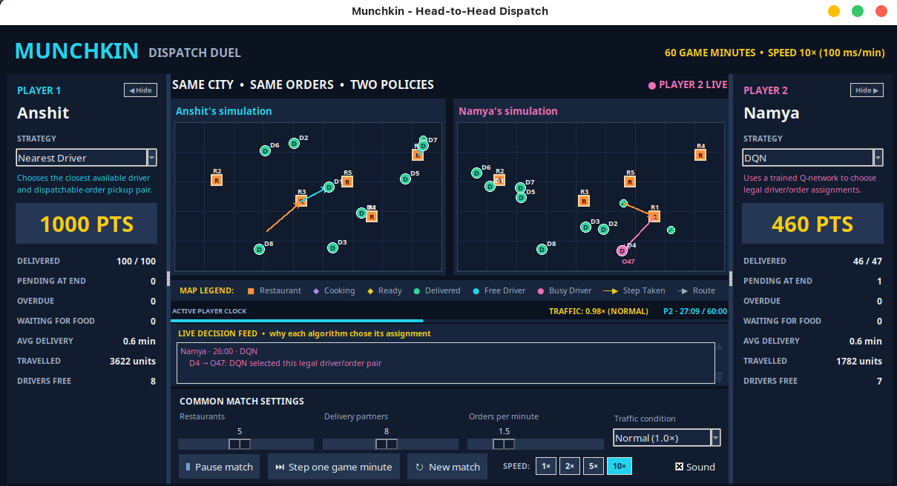
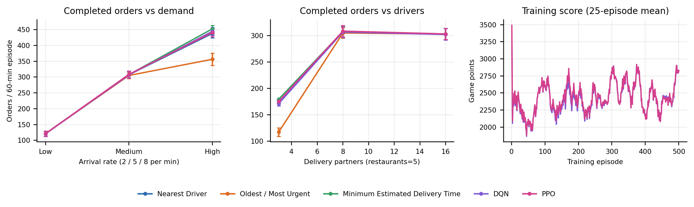

# Munchkin: RL-Based Dynamic Food Delivery Dispatch System

Munchkin is a small food-delivery dispatch simulator and strategy-comparison game. It models orders arriving over time, restaurant preparation, traffic, deadlines, and a limited fleet of delivery partners. Players can compare three dispatch heuristics with trained Deep Q-Network (DQN) and Proximal Policy Optimization (PPO) policies in the graphical game or in repeatable command-line experiments.

**Repository:** [Anshit2005/Munchkin](https://github.com/Anshit2005/Munchkin---RL-Based-Dynamic-Food-Delivery-Dispatch-System)

**Team:** Anshit Agarwal and Namya Dhingra

## Visual overview

The preview shows the two-player dispatch interface. The chart summarizes the saved five-seed comparisons across demand levels and driver counts, alongside the 25-episode moving-average training scores.





## Quick start

These steps install the project, launch the game, and run the five-policy scenario report. The repository includes trained DQN and PPO checkpoints, so the comparison commands work without training first.

### 1. Requirements and installation

- Python 3.10 or newer
- Tkinter for the desktop game (often included with Python)
- NumPy and PyTorch for reinforcement-learning policies and training

Clone the repository and enter its folder:

```bash
git clone https://github.com/Anshit2005/Munchkin---RL-Based-Dynamic-Food-Delivery-Dispatch-System.git
cd Munchkin---RL-Based-Dynamic-Food-Delivery-Dispatch-System
```

Create and activate a virtual environment, then install Python dependencies:

```bash
python3 -m venv .venv
source .venv/bin/activate
python -m pip install --upgrade pip
python -m pip install -r requirements.txt
```

On Windows PowerShell, activate the environment with:

```powershell
.\.venv\Scripts\Activate.ps1
```

On Ubuntu/Debian, if importing Tkinter fails, install the operating-system package and retry:

```bash
sudo apt update
sudo apt install python3-tk
```

`requirements.txt` installs NumPy and PyTorch. Tkinter is provided by Python/your operating system, not by this requirements file.

### 2. Play the game

From the repository root with the virtual environment active:

```bash
python -m food_delivery_game
```

Enter names for Player 1 and Player 2, choose one strategy for each, then set the shared order rate, restaurant count, driver count, and traffic. Start the match to run each player's 60-game-minute simulation in sequence, or step the active simulation one game minute at a time. The speed buttons change playback speed; they do not change the simulated episode length. Each player sees their map, live dispatch feed, deliveries, pending orders, score, average delivery time, distance, and available drivers.

Strategies in the player selector are:

- **Nearest Driver** — assigns the available driver/order pair with the shortest driver-to-restaurant pickup distance.
- **Oldest / Most Urgent** — selects the order with the least estimated deadline slack, breaking ties by age, then sends the driver with the shortest estimated completion time.
- **Minimum Estimated Delivery Time** — selects the legal driver/order assignment with the shortest estimated delivery time.
- **DQN** and **PPO** — load the included trained policy checkpoints.

### 3. Reproduce the model comparisons

Run the standard terminal report for all three baselines, DQN, and PPO across low, medium, and high demand. It uses five matched random seeds per scenario by default and prints completed orders, game points, shaped RL reward, delivery time, and distance:

```bash
python -m food_delivery_game.rl.scenario_report
```

Choose the number of matched episodes, horizon, seed, fleet, or restaurant count with:

```bash
python -m food_delivery_game.rl.scenario_report --episodes 10 --minutes 60 --seed 2026 --drivers 8 --restaurants 5
```

To run one matched-seed comparison at a chosen demand and traffic level, comparing all available baselines and RL checkpoints:

```bash
python -m food_delivery_game.rl.evaluate --episodes 20 --minutes 60 --seed 1000 --drivers 8 --restaurants 5 --orders-per-minute 5
```

This command writes `results/rl_comparison.csv` as well as printing the summary. For a baseline-only comparison (no trained checkpoint required), use:

```bash
python -m food_delivery_game.compare --episodes 20 --minutes 60 --seed 7 --drivers 8 --restaurants 5 --orders-per-minute 5 --traffic normal
```

### 4. Train or retrain DQN and PPO

The saved checkpoints are included at `models/dqn.pt` and `models/ppo.pt`, with metadata in the corresponding `.meta.json` files. To reproduce training, train each model from the repository root:

```bash
python -m food_delivery_game.rl.train --algorithm dqn --episodes 500
python -m food_delivery_game.rl.train --algorithm ppo --episodes 500
```

Training evaluates on fixed low-demand/light-traffic, medium-demand/normal-traffic, and high-demand/heavy-traffic scenarios every 25 episodes, retaining the best validation checkpoint. It writes weights and metadata to `models/`, and per-episode training logs to `models/dqn_training.csv` and `models/ppo_training.csv`. To run a shorter smoke-scale training session, reduce `--episodes`; such a run is not comparable to the supplied 500-episode checkpoints.

After retraining, rerun the scenario report or parameter sweep to compare the newly saved models with the baselines. If checkpoints are missing or reported as incompatible, run both training commands above first.

### 5. Generate the multi-configuration report

Run the full evaluation suite to compare all five policies across demand, traffic, restaurant count, driver count, and two capacity-stress scenarios:

```bash
python -m food_delivery_game.rl.parameter_report
```

By default, it evaluates five matched episodes for each of 11 configurations and each strategy, then writes:

- `results/parameter_report.md` — readable tables and experiment method
- `results/parameter_report_summary.csv` — per-configuration means and standard deviations
- `results/parameter_report_episodes.csv` — raw episode-level measurements

For a faster check or a larger experiment with a separate output directory:

```bash
python -m food_delivery_game.rl.parameter_report --episodes 1 --minutes 60
python -m food_delivery_game.rl.parameter_report --episodes 10 --minutes 60 --seed 1234 --output-dir results/full_run
```

Five seeds provide a repeatable screening comparison, not strong statistical evidence. Increase `--episodes` for more stable estimates. The full sweep runs 11 configurations × 5 policies × N episodes and may take a while.

## Project and game rules

Each match is a one-hour simulation for each player. One real second corresponds to one game minute at normal playback speed. Player 1 runs first and Player 2 then runs the same pre-sampled scenario. Their strategy is the experimental variable; restaurant and driver locations, customer locations, order arrivals, preparation samples, deadlines, and traffic sequence are shared.

- The city map is 100 × 70 units. Restaurant placement targets at least 12 units between restaurants, relaxing when the map is crowded. A customer's location is sampled within 28 units of the restaurant and clipped to the map.
- Orders arrive at the configured average rate according to a Poisson process. The opening backlog is half the order rate, rounded to an integer.
- Actual preparation time is sampled from a normal distribution (mean 0.5, standard deviation 0.17 game minutes), clipped to 0.15–1.0 minutes. Dispatchers receive a noisy estimate; a driver can be sent while food is still preparing and waits at the restaurant if it arrives early.
- The deadline estimate is preparation estimate + nominal restaurant-to-customer travel time + five minutes of slack. Traffic varies during the episode around the selected traffic level.
- Light, normal, and heavy traffic use speed multipliers 1.2×, 1.0×, and 0.7× respectively. The simulation adds minute-to-minute traffic noise, clipped to 0.5×–1.5× the selected nominal speed.
- Each completed delivery is worth 10 game points. Orders still preparing, awaiting a driver, or in transit at the 60-minute cutoff remain pending. The higher score wins; ties use lower average delivery time, then shorter total travel distance.
- The main simulator supports one order per driver at a time; it does not support multi-order batching.

The game scoreboard and the RL training reward are different objectives. The shaped reward, accumulated per simulated minute, is:

```text
R = 10 × deliveries − 2 × pending_orders − 4 × overdue_orders
    − 0.1 × distance − idle_driver_cost − 5 × unfinished_orders_at_cutoff
```

The idle-driver cost is charged when available capacity and dispatchable orders coexist. The terminal unfinished-order penalty applies at the episode cutoff. Batch-savings reward is zero because batching is not implemented. The UI/game winner is determined by game points and tie-breakers, not the shaped RL return.

## RL problem and algorithms

At each simulated minute, the agent receives a fixed-size observation with **1,849 values**: 16 driver records × 11 features, 64 order records × 10 features, a 16 × 64 driver/order ETA matrix, and 9 global features. Features represent positions, availability and movement state, estimated time until a driver is free, order age and preparation/deadline estimates, ETA pairs, demand, remaining horizon, traffic, and resource counts. The padded representation supports up to 16 drivers and 64 dispatchable orders. Invalid driver/order pairs are masked.

The discrete action space has **1,025 actions**: 16 × 64 driver/order assignments and one `WAIT` action. A dispatch action does not advance time, so multiple assignments can be made before `WAIT` advances the simulation by one minute.

- **DQN:** pairwise action-value network (128 hidden units) with masked Double-DQN targets, uniform replay buffer (20,000 transitions), batch size 128, learning rate 0.0003, discount 0.99, learning begins after 32 transitions, updates every four steps, target synchronization every 1,000 steps, and epsilon annealed from 1.0 to 0.05.
- **PPO:** masked categorical pairwise policy (128 hidden units) and value network (256 hidden units), clipped objective (clip 0.2), discount 0.99, GAE λ 0.95, 8 update epochs, minibatches of 128, and learning rate 0.0003. PPO samples actions during training; evaluation and game play use deterministic masked action selection.
- Both models train for 500 episodes by default with randomized demand, restaurant count, driver count, and traffic. Shaped rewards are scaled by 0.1 for neural-network updates. The best checkpoint is selected by mean shaped reward on fixed validation scenarios. Evaluation uses the same simulator and action masks as training.

## Current results

The table below summarizes the saved five-seed parameter sweep for normal traffic with five restaurants and eight drivers. “Points” equal 10 × completed deliveries in this game. The score and RL reward can rank strategies differently because RL reward also penalizes waiting, lateness, travel, idle capacity, and unfinished orders.

| Policy | Low demand: delivered / points | Medium demand: delivered / points | High demand: delivered / points |
|---|---:|---:|---:|
| Nearest Driver | 121.2 / 1,212 | 307.4 / 3,074 | 437.8 / 4,378 |
| Oldest / Most Urgent | 121.0 / 1,210 | 305.0 / 3,050 | 356.2 / 3,562 |
| Minimum Estimated Delivery Time | 121.2 / 1,212 | 307.8 / 3,078 | 452.4 / 4,524 |
| DQN | 120.6 / 1,206 | 306.8 / 3,068 | 444.4 / 4,444 |
| PPO | 121.2 / 1,212 | 308.6 / 3,086 | 440.8 / 4,408 |

At medium demand PPO has the highest mean game score in this sweep, while Minimum Estimated Delivery Time is nearly tied. At high demand, Minimum Estimated Delivery Time completes the most deliveries. DQN has the best mean shaped RL reward in that high-demand comparison, even though it does not have the highest game score. The learned policies are competitive in some conditions but do **not** outperform the heuristics consistently. The full sweep includes isolated traffic, restaurant-count, and driver-count changes plus undersupplied and well-resourced high-demand cases; see `results/parameter_report.md` for all configurations and variability.

The project report is available in [`output/pdf/munchkin_rl_report.pdf`](output/pdf/munchkin_rl_report.pdf), with editable LaTeX source in [`reports/munchkin_rl_report/main.tex`](reports/munchkin_rl_report/main.tex). The report describes the experiment and current results; rerun the parameter report commands above to reproduce the comparisons from the included checkpoints.

## Repository layout

```text
food_delivery_game/
  baselines/       Nearest Driver, Oldest/Most Urgent, Minimum ETA
  simulation/      Shared episode runner and evaluation metrics
  rl/              Observation, DQN/PPO, training, and reports
  __main__.py      Tkinter game entry point
  config.py        Shared simulation settings
  environment.py   Order, restaurant, driver, and traffic simulation
  ui.py            Interactive two-player game interface
models/            Trained DQN/PPO checkpoints and metadata
results/           Generated CSV and Markdown experiment reports
reports/           Two-page LaTeX project report and chart source
output/pdf/         Rendered report PDF
```

## Reproducibility notes

The CLI experiment tools use fixed or explicitly supplied seeds and matched scenarios so every strategy is compared on the same random conditions. Training is stochastic and can vary with hardware and library versions; checkpoints record the observation version and training metadata. Keep the `.pt` files together with their `.meta.json` files when sharing trained models. If the observation version changes, retrain both models before evaluating them.
